# Autos Colombia — Documentación de la Iteración 1

**Alcance de la iteración:** gestión de la entrada y salida de vehículos del parqueadero.
Quedan para iteraciones siguientes: registro de usuarios y mensualidades, novedades, pagos y administración de celdas.

## Contenido

1. [Requerimientos funcionales y no funcionales](#1-requerimientos)
2. [Historias de usuario](#2-historias-de-usuario)
3. [Arquitectura del sistema](#3-arquitectura-del-sistema)
4. [Mockups](#4-mockups)
5. [Modelo de datos: MER, MR y modelo físico](#5-modelo-de-datos)
6. [Diagrama de casos de uso](#6-diagrama-de-casos-de-uso)
7. [Diagrama de clases](#7-diagrama-de-clases)
8. [Diagrama de paquetes](#8-diagrama-de-paquetes)
9. [Pantallas implementadas](#9-pantallas-implementadas)

Los diagramas están escritos en PlantUML (código UML) en [`docs/uml/`](uml/) y exportados como imagen en [`docs/img/`](img/).

---

## 1. Requerimientos

### Requerimientos funcionales

| ID | Requerimiento | Descripción |
| --- | --- | --- |
| RF-01 | Registrar entrada | Registrar la entrada de un vehículo con su placa, la celda asignada y la fecha y hora del servidor. |
| RF-02 | Validar placa | Validar el formato de placa colombiana (carro `ABC123`, moto `ABC12D`) y deducir de él el tipo de vehículo. |
| RF-03 | Registrar vehículo nuevo | Si la placa no existe, registrar el vehículo automáticamente en su primera entrada. |
| RF-04 | Asignar celda libre | Ofrecer solo las celdas libres del tipo del vehículo, proponiendo la primera libre. |
| RF-05 | Impedir dobles registros | No permitir la entrada de un vehículo que ya está dentro, ni asignar una celda ocupada. |
| RF-06 | Registrar salida | Buscar el vehículo por placa, guardar la hora de salida y liberar la celda. |
| RF-07 | Mostrar permanencia | Mostrar el tiempo que el vehículo estuvo en el parqueadero al registrar su salida. |
| RF-08 | Consultar vehículos dentro | Listar los vehículos dentro con placa, tipo, celda, hora de entrada y tiempo transcurrido. |
| RF-09 | Consultar disponibilidad de celdas | Mostrar el plano de celdas libres y ocupadas, por tipo de vehículo. |
| RF-10 | Consultar historial | Listar las entradas y salidas, de la más reciente a la más antigua, con filtro por placa. |

### Requerimientos no funcionales

| ID | Tipo | Descripción |
| --- | --- | --- |
| RNF-01 | Usabilidad | Registrar una entrada o una salida en máximo tres pasos. Interfaz en español y mensajes de error que dicen cómo corregir. |
| RNF-02 | Integridad de datos | La base de datos garantiza las reglas aunque dos operadores trabajen a la vez: placa única, un solo registro abierto por vehículo y por celda, y salida posterior a la entrada. Cada operación es una transacción. |
| RNF-03 | Rendimiento | Registrar una entrada o salida responde en menos de 2 segundos en la red local. |
| RNF-04 | Compatibilidad | Funciona en navegadores modernos (Chrome, Edge, Firefox) y se adapta a escritorio y celular. |
| RNF-05 | Accesibilidad | Contraste AA, uso completo con teclado y etiquetas en todos los campos. |
| RNF-06 | Fecha y hora | Las fechas se guardan con zona horaria y se muestran en hora de Colombia (America/Bogota), sin importar el equipo. |
| RNF-07 | Seguridad | Consultas SQL parametrizadas y credenciales en el archivo `.env`, fuera del repositorio. La autenticación de operadores queda para una próxima iteración. |
| RNF-08 | Tecnología y mantenibilidad | Next.js (full stack), shadcn/ui y PostgreSQL, con arquitectura en capas. Instalación con tres comandos (ver README principal). |

---

## 2. Historias de usuario

**HU-01 · Registrar entrada de vehículo**
Como operador del parqueadero, quiero registrar la entrada de un vehículo con su placa y una celda libre, para controlar qué vehículos están dentro y dónde.
- Dado que escribo una placa válida, el sistema detecta si es carro o moto y propone la primera celda libre de ese tipo.
- Dado que la placa no está registrada, al confirmar se registra el vehículo y su entrada.
- Dado que el vehículo ya está dentro o la celda está ocupada, el sistema no registra la entrada y muestra el motivo.
- Prioridad: alta · Estimación: 5 puntos.

**HU-02 · Registrar salida de vehículo**
Como operador, quiero registrar la salida de un vehículo buscándolo por su placa, para liberar su celda y saber cuánto tiempo estuvo.
- Dado que busco una placa que está dentro, veo su celda, hora de entrada y tiempo dentro, y puedo confirmar la salida.
- Al confirmar, se guarda la hora de salida, la celda queda libre y se muestra la permanencia.
- Dado que la placa no está dentro, el sistema lo indica y no registra nada.
- Prioridad: alta · Estimación: 3 puntos.

**HU-03 · Consultar vehículos dentro**
Como operador, quiero ver la lista de vehículos que están dentro, para saber quién ocupa cada celda y desde cuándo.
- La lista muestra placa, tipo, celda, hora de entrada y tiempo transcurrido, y permite ir a registrar la salida.
- Si no hay vehículos, se muestra un mensaje con acceso a registrar una entrada.
- Prioridad: media · Estimación: 2 puntos.

**HU-04 · Consultar disponibilidad de celdas**
Como operador, quiero ver un plano con las celdas libres y ocupadas, para orientar al conductor rápidamente.
- El plano separa carros y motos e indica cuántas celdas libres hay de cada tipo.
- Las celdas ocupadas muestran la placa del vehículo.
- Prioridad: media · Estimación: 2 puntos.

**HU-05 · Consultar historial de entradas y salidas**
Como operador, quiero consultar el historial de movimientos y filtrarlo por placa, para resolver dudas sobre un vehículo.
- El historial muestra placa, tipo, celda, entrada, salida, permanencia y estado (dentro o finalizado).
- Puedo filtrar por una placa completa o parcial.
- Prioridad: baja · Estimación: 2 puntos.

---

## 3. Arquitectura del sistema

Aplicación web cliente-servidor en tres capas. Next.js funciona como *full stack*: genera las pantallas y ejecuta en el servidor la lógica y el acceso a PostgreSQL.

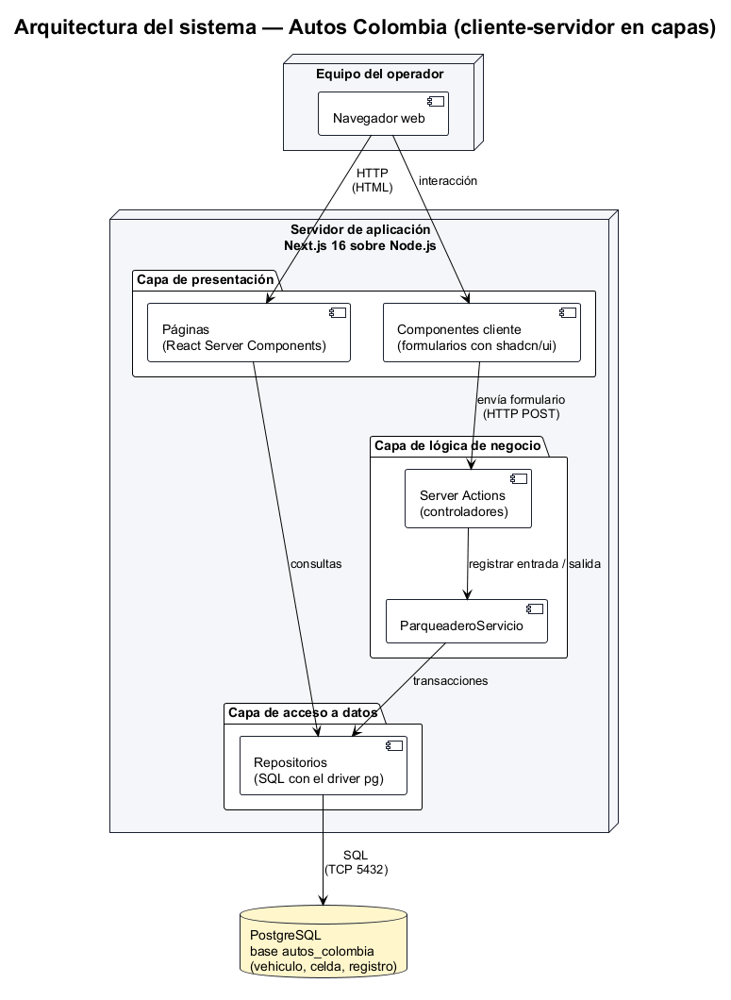

| Capa | Carpeta | Responsabilidad |
| --- | --- | --- |
| Presentación | `src/app`, `src/components` | Páginas y componentes de pantalla (shadcn/ui). |
| Lógica de negocio | `src/acciones`, `src/servicios` | Server Actions que reciben los formularios y servicio con las reglas del parqueadero. |
| Acceso a datos | `src/repositorios` | Consultas SQL a PostgreSQL con el driver `pg`. |
| Dominio | `src/modelos` | Entidades (Vehículo, Celda, Registro) y reglas como la validación de la placa. |

Código UML: [`uml/arquitectura.puml`](uml/arquitectura.puml)

---

## 4. Mockups

Bocetos de baja fidelidad de cada historia de usuario. Las pantallas reales están en la [sección 9](#9-pantallas-implementadas).

**HU-01 · Registrar entrada**

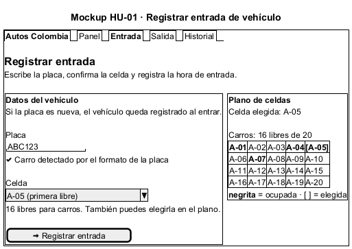

**HU-02 · Registrar salida**

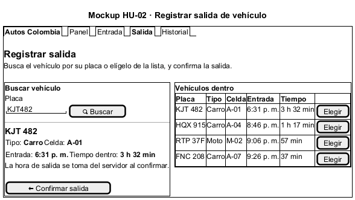

**HU-03 y HU-04 · Panel: vehículos dentro y disponibilidad de celdas**

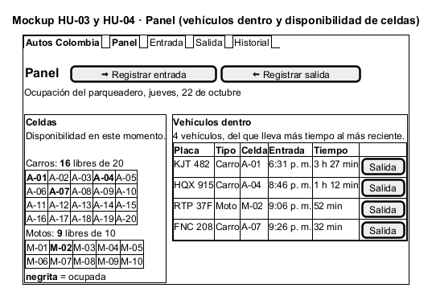

**HU-05 · Historial**

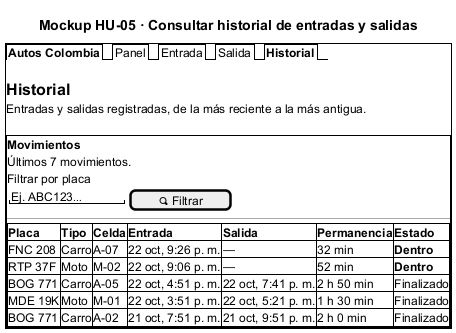

Código: [`uml/mockup-*.puml`](uml/) (PlantUML Salt)

---

## 5. Modelo de datos

### MER (modelo entidad-relación)

- Un **vehículo** realiza muchos **registros** (uno por cada vez que entra); cada registro es de un solo vehículo.
- Una **celda** se ocupa en muchos **registros** a lo largo del tiempo; cada registro usa una sola celda.
- Un registro sin fecha de salida significa que el vehículo sigue dentro.

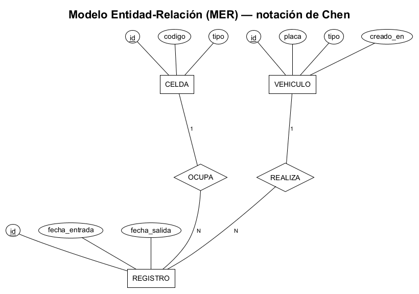

### MR (modelo relacional)

<pre>
VEHICULO (<u>id</u>, placa, tipo, creado_en)
CELDA    (<u>id</u>, codigo, tipo)
REGISTRO (<u>id</u>, <i>vehiculo_id</i>, <i>celda_id</i>, fecha_entrada, fecha_salida)
</pre>

Subrayado: llave primaria. En cursiva: llave foránea (`REGISTRO.vehiculo_id → VEHICULO.id`, `REGISTRO.celda_id → CELDA.id`).

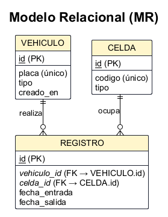

### Modelo físico (PostgreSQL)

El modelo físico es el script [`db/schema.sql`](../db/schema.sql), que se ejecuta con `npm run db:setup`. Los datos iniciales (30 celdas y movimientos de ejemplo) están en [`db/seed.sql`](../db/seed.sql).

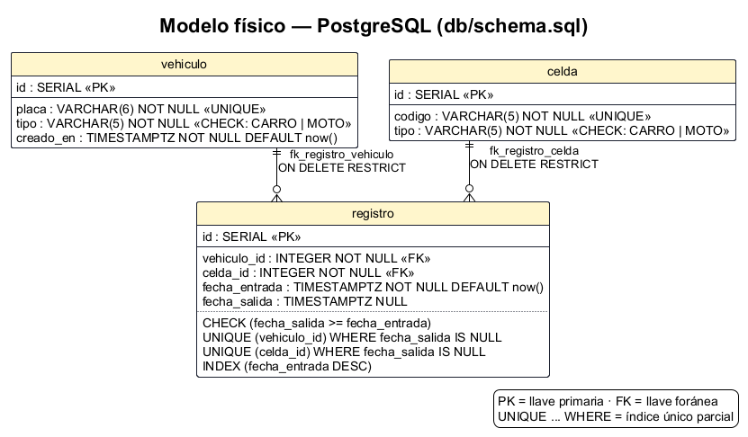

Los dos índices únicos parciales (`WHERE fecha_salida IS NULL`) son los que impiden, incluso con dos operadores a la vez, que un vehículo entre dos veces o que una celda tenga dos vehículos.

Código UML: [`uml/mer.puml`](uml/mer.puml), [`uml/modelo-relacional.puml`](uml/modelo-relacional.puml), [`uml/modelo-fisico.puml`](uml/modelo-fisico.puml)

---

## 6. Diagrama de casos de uso

El operador del parqueadero es el único actor de esta iteración.

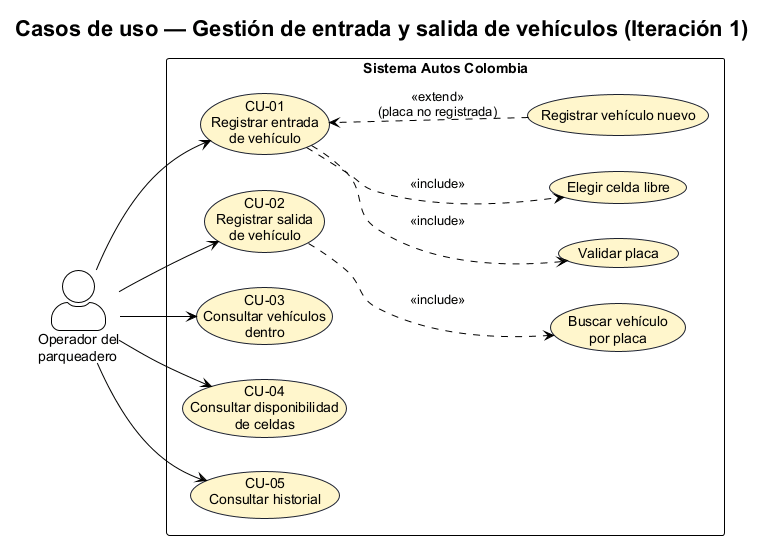

| Caso de uso | Historia | Pantalla |
| --- | --- | --- |
| CU-01 Registrar entrada de vehículo | HU-01 | Entrada |
| CU-02 Registrar salida de vehículo | HU-02 | Salida |
| CU-03 Consultar vehículos dentro | HU-03 | Panel y Salida |
| CU-04 Consultar disponibilidad de celdas | HU-04 | Panel y Entrada |
| CU-05 Consultar historial | HU-05 | Historial |

Código UML: [`uml/casos-de-uso.puml`](uml/casos-de-uso.puml)

---

## 7. Diagrama de clases

Entidades del dominio, el servicio con las reglas de negocio y los repositorios que acceden a la base de datos.

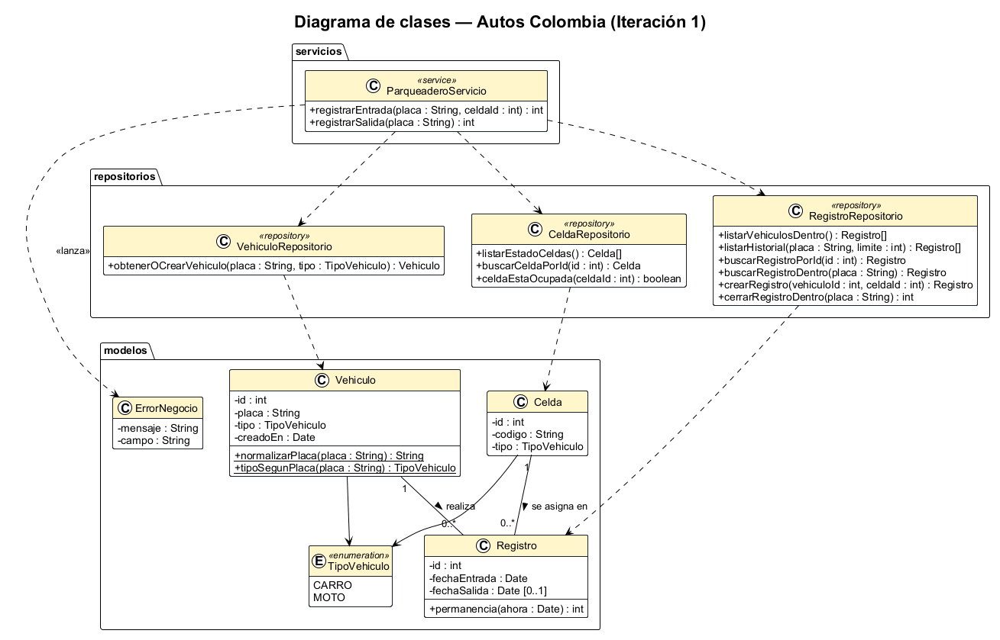

Correspondencia con el código: `src/modelos/index.ts` (entidades), `src/servicios/parqueadero.ts` (ParqueaderoServicio) y `src/repositorios/*.ts` (repositorios). En TypeScript las clases del diagrama se implementan como tipos y módulos de funciones.

Código UML: [`uml/clases.puml`](uml/clases.puml)

---

## 8. Diagrama de paquetes

Cada paquete es una carpeta dentro de `src/`. Las dependencias van de la presentación hacia los datos, nunca al revés.

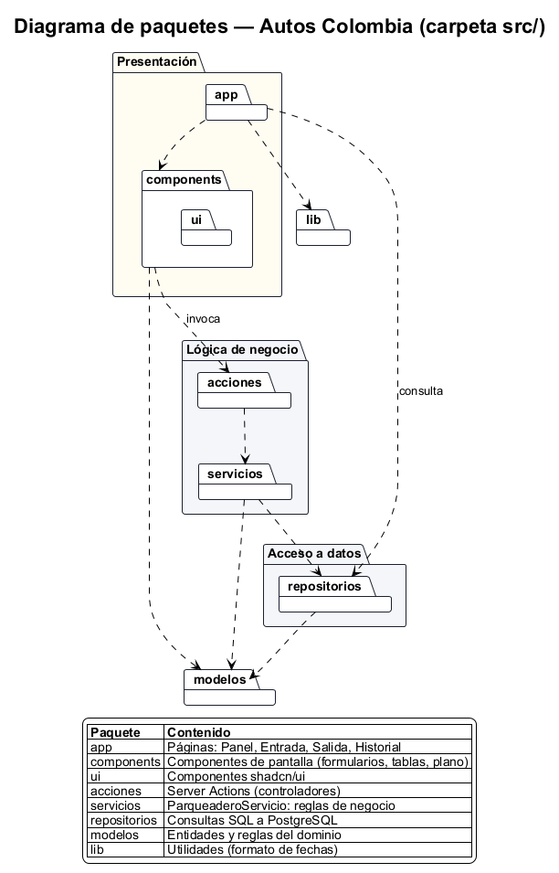

Código UML: [`uml/paquetes.puml`](uml/paquetes.puml)

---

## 9. Pantallas implementadas

**Panel (HU-03 y HU-04)**

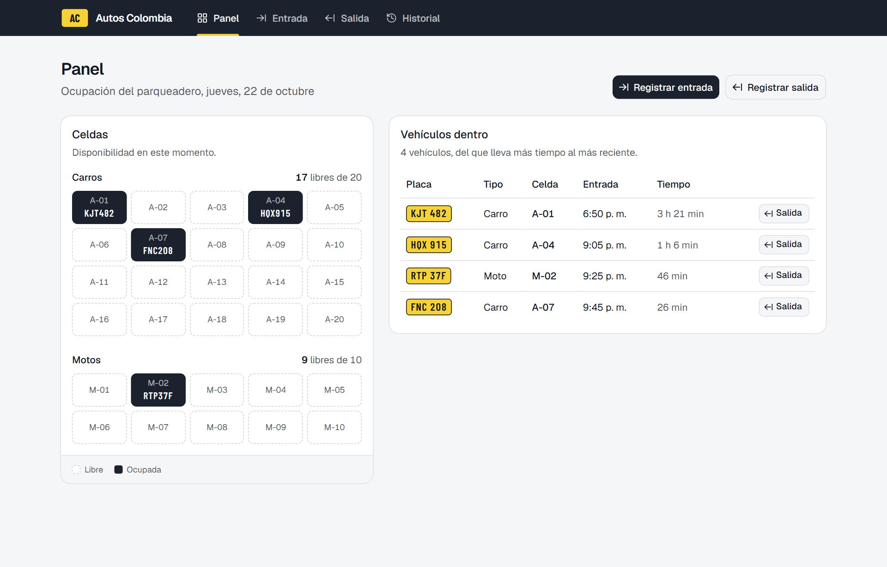

**Registrar entrada (HU-01)**

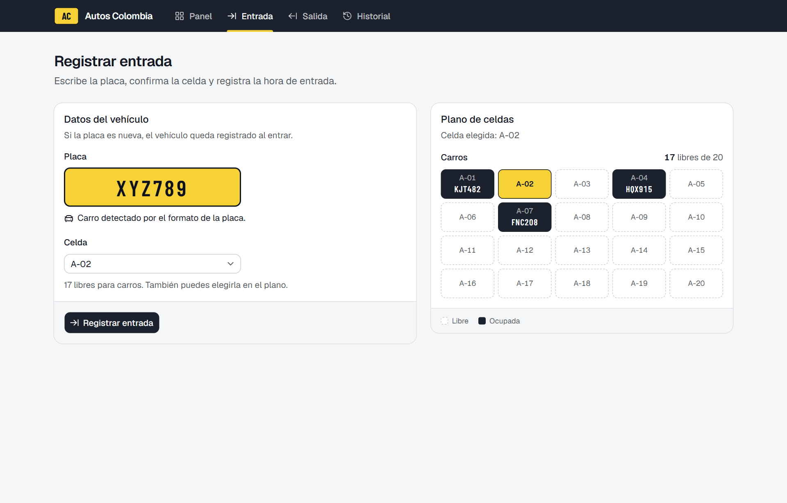

**Registrar salida (HU-02)**

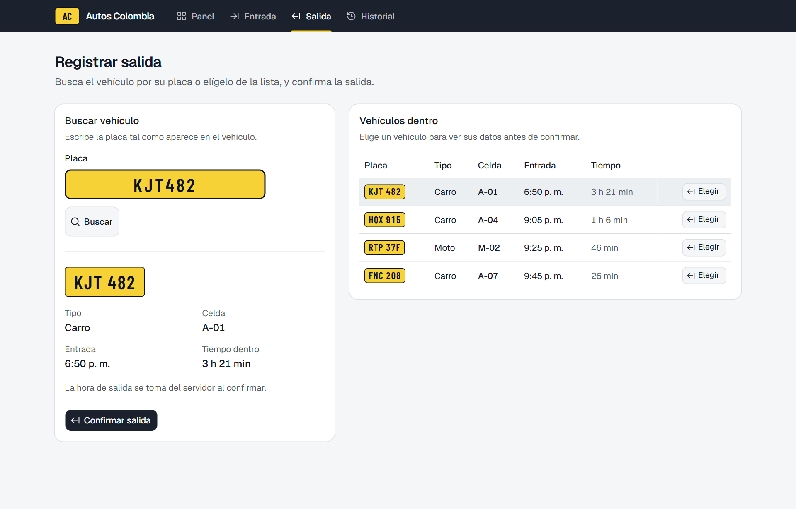

**Historial (HU-05)**

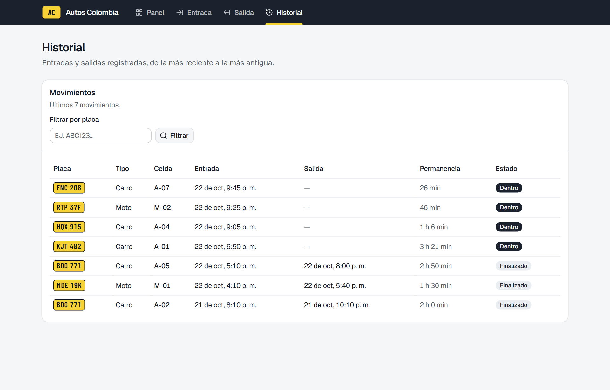

---

### Cómo editar los diagramas

Los archivos `.puml` se abren con cualquier editor de PlantUML, por ejemplo la extensión *PlantUML* de VS Code o el editor en línea <https://www.plantuml.com/plantuml>. Para regenerar las imágenes con Java instalado:

```bash
java -jar plantuml.jar -charset UTF-8 -tpng -o ../img docs/uml/*.puml
```
